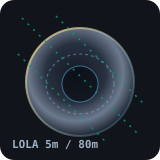
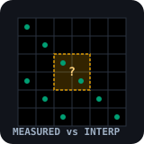
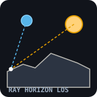
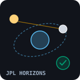

<div align="center">

<picture>
  <source media="(prefers-color-scheme: dark)" srcset="./public/brand/logo-white-crop.svg">
  <source media="(prefers-color-scheme: light)" srcset="./public/brand/logo-black-crop.svg">
  
</picture>

<p><b>Lunar South Pole Landing Site Decision-Support Tool (80°S–90°S)</b><br>
Built by <b>Team HECATE</b> for the <a href="https://www.spaceappschallenge.org/2026/challenges/lunar-landing-site-navigator/">2026 NASA Space Apps Challenge — Lunar Landing Site Navigator</a></p>

<p>
  <a href="#overview">Overview</a> ·
  <a href="#the-south-pole-challenge">Why the South Pole?</a> ·
  <a href="#how-it-works">How It Works</a> ·
  <a href="#mission-baselines">Mission Baselines</a> ·
  <a href="#nasa-data-registry">Data Registry</a> ·
  <a href="#controls">Controls</a> ·
  <a href="#installation--quick-start"><b>Installation & Quick Start ↓</b></a>
</p>

</div>

---

## Overview

**HECATE** is an interactive mission-planning web application developed by **Team HECATE** for the [**2026 NASA Space Apps Challenge: Lunar Landing Site Navigator**](https://www.spaceappschallenge.org/2026/challenges/lunar-landing-site-navigator/).

Missions targeting the Moon's South Pole (`80°S–90°S`) face extreme lighting and communication constraints caused by steep terrain and very low Sun and Earth angles. Existing planetary data tools are often fragmented, making it slow to evaluate when and where a lander or rover can survive.

HECATE brings real NASA Lunar Reconnaissance Orbiter (LRO) topography and orbital mechanics into a single browser interface so mission planners, engineers, and students can:
1. **Screen the entire South Polar region (`80°S–90°S`)** to find viable landing zones for a chosen launch window and mission type (**Forward Search**).
2. **Inspect and compare specific landing sites**—either from 12 curated Artemis III and CLPS targets or any custom coordinate—across solar illumination, Direct-to-Earth (DTE) communication windows, surface slope, and data reliability (**Site Analysis**).

---

## The South Pole Challenge

Because the Moon's spin axis is tilted by only `1.54°` relative to the ecliptic, the Sun at the South Pole never rises more than a few degrees above the horizon. Every landing site trade study must balance four physical realities:

- **Grazing Sunlight & Long Shadows**: Ridges up to `150 km` away can block the Sun at a landing site. Because the solar disk is `0.53°` wide, mountain rims frequently clip part of the Sun, reducing solar panel power before full darkness begins.
- **Illuminated Peaks Next to Cold Traps**: Elevated crater rims (*Shackleton Rim*, *Connecting Ridge*, *Malapert Massif*) receive sunlight for most of the lunar year, while adjacent crater floors sit in **Permanently Shadowed Regions (PSRs)** below `110 K` that preserve water ice.
- **Earth Libration & Communications**: Over each lunar orbit, Earth moves within a `±6.7°` latitude and `±7.9°` longitude window in the lunar sky. A site with clear S/X-band line-of-sight at touchdown can lose Earth behind a local ridge days later.
- **Grid Spacing vs. Actual Measurements**: Polar elevation maps are published on a `5 m/px` grid, but LOLA laser altimeter tracks spread apart away from `90°S`. Many `5 m` pixels are interpolated between tracks rather than directly measured. HECATE tracks laser shot counts per pixel so unmeasured terrain is never mistaken for safe terrain.

---

## How It Works

### 1. Forward Search (Regional Screening, `80°S–90°S`)
Screens the South Polar cap on a `4.75 km` grid derived from the `80 m` track-adjusted LOLA regional DEM:
- Evaluates nominal touchdown (`t₀`), launch-slip windows (`t₀ ± Δt`), and surface stay duration (`T_mission`) in a background Web Worker.
- Uses a two-stage temporal solver: a 1-hour coarse scan brackets horizon crossings, and Brent's method refines sunrise, sunset, and Earth-occultation times to within `2 s`.
- Ranks passing candidate cells by engineering margin while separating low-confidence cells.

### 2. Site Analysis (Point & Footprint Inspection)
Inspects any coordinate within `80°S–90°S` or 12 curated Artemis III / CLPS candidate sites (*Connecting Ridge*, *Shackleton Rim*, *de Gerlache Rim*, *Slater Plain*, *Haworth*, *Malapert Massif*, *Nobile Rim 1 & 2*, *Mons Mouton*, *Mons Mouton Plateau*, *Peak near Cabeus B*, and *IM-1 Odysseus*):
- **Feasibility Verdict**: Classifies sites as `PASS`, `FAIL`, or `UNKNOWN / LOW CONFIDENCE`. Violating any mandatory constraint (such as max slope or max darkness) results in `FAIL` regardless of other scores.
- **360° Horizon Panorama**: Ray-casts local terrain out to `150 km` with planetary curvature correction, plotting the horizon profile, vertical error band, Sun path, and Earth libration track.
- **Solar Array Power Budget**: Calculates instantaneous power (`W`), total mission energy (`kWh`), continuous post-landing sunlight, and longest darkness period over the mission window.
- **Side-by-Side Comparison**: Compares multiple pinned sites across all lighting, communication, terrain, and science metrics.

### 3. 3D Globe & 2D Polar Map
- **3D WebGL Globe**: Streams LOLA terrain down to `5 m/px` near the pole with continuous level-of-detail (LOD) vertex morphing, real-time GPU cast shadows, and optional `100 m` LROC WAC imagery from NASA Moon Trek.
- **2D Polar Stereographic Map**: Displays `80°S–90°S` with switchable layers: shaded relief, feasibility heatmaps, live Sun/Earth visibility (`⏱`), PSR outlines, slope, Terrain Ruggedness Index (TRI), Mini-RF radar Circular Polarization Ratio (CPR), and data confidence.
- **Interactive `[i]` Reference Cards**: Hovering any parameter shows its definition, live value for the inspected site, and NASA technical source.

---

## Mission Baselines

Three literature-backed mission presets are included (all thresholds can be customized in the left panel or **Settings → Advanced**):

| Parameter | Artemis III Crewed HLS | CLPS Polar Solar Lander | VIPER-Class Polar Rover | Reference |
| :--- | :---: | :---: | :---: | :--- |
| **Launch Slip Window** | `±72 h` (`±3 d`) | `±336 h` (`±14 d`) | `±336 h` (`±14 d`) | Mission planning baseline |
| **Surface Stay Duration** | `156 h` (`6.5 d`) | `240 h` (`10 d`) | `336 h` (`14 d`) | NASA SP-2020-5009602 §2.1 |
| **Min Solar Clearance** | `1.5°` (mast array) | `5.0°` (deck array) | `2.0°` (mast array) | NASA-STD-1008 / M2M-30044 |
| **Min Continuous Sunlight** | `156 h` (full stay) | `192 h` | `96 h` | NASA SP-2020-5009602 |
| **Max Darkness Survived** | `0 h` (no eclipse) | `12 h` | `60 h` | NASA M2M-30044 |
| **Direct-to-Earth (DTE)** | `100%` above `2.0°` | `≥90%` above `2.0°` | `≥70%` above `2.0°` | HLS-CONOP-008 |
| **Max Slope (`L_base`)** | `8°` (`5 m` baseline) | `10°` (`5 m` baseline) | `15°` (`100 m` baseline) | NASA SP-2020-5009602 |
| **3σ Landing Ellipse** | `100 m` (`≥95%` cells pass) | `500 m` (`≥95%` cells pass) | `500 m` (`≥95%` cells pass) | GN&C footprint requirement |
| **PSR Proximity Filter** | Optional (`≤2 km` EVA) | Optional (`≤10 km`) | Active (`≤10 km` traverse) | Artemis III SDT Report |

---

## Scientific Design Principles

<table>
  <tr>
    <td width="64" align="center"></td>
    <td><b>Real NASA Terrain</b><br>All topography comes directly from LRO LOLA altimetry: <code>5 m</code> polar DEMs, PGDA Product 78 track-adjusted Artemis site patches, the PGDA Product 90 <code>80 m</code> regional DEM, and the <code>16 ppd</code> global model.</td>
  </tr>
  <tr>
    <td width="64" align="center"></td>
    <td><b>Resolution Honesty</b><br>A <code>5 m</code> grid is not <code>5 m</code> of measurement where orbital tracks diverge. Cells without sufficient LOLA shot counts or effective resolution are marked <code>UNKNOWN / LOW CONFIDENCE</code>, never <code>PASS</code>.</td>
  </tr>
  <tr>
    <td width="64" align="center"></td>
    <td><b>Geometric Scope</b><br>Sunlight models geometric visibility of the <code>0.53°</code> solar disk above the terrain horizon; DTE models line-of-sight clearance (not an RF link budget); Mini-RF CPR is kept as an independent S-band radar roughness layer.</td>
  </tr>
  <tr>
    <td width="64" align="center"></td>
    <td><b>Two-Tier Ephemeris</b><br>Tier 1 runs locally (<code>astronomy-engine</code> + IAU lunar orientation) for fast screening; Tier 2 cross-checks inspected sites live against the <b>NASA JPL Horizons</b> API when online.</td>
  </tr>
</table>

---

## NASA Data Registry

| Dataset | Role in HECATE | Source | Resolution & Coverage |
| :--- | :--- | :--- | :--- |
| **Level 0 Global** | Whole-Moon relief & base imagery | NASA SVS 4720 CGI Moon Kit (`ldem_16` + LROC WAC) | `16 ppd` (`~1.9 km`); `4K` local + `100 m` Moon Trek stream |
| **Polar 5 m Cap** | Site slope, TRI, 5 m horizons, close-up relief | LRO LOLA GDR `LDEM_875S_5M` + `LDEC_875S_5M` (PDS) | `5 m/px`, `87.5°S–90°S` + per-pixel shot counts |
| **Artemis Site DEMs** | Track-adjusted `5 m` terrain & vertical error | NASA GSFC PGDA Product 78 (Barker et al. 2021) | `5 m/px`, `16–21 km` patches at 7 South Pole sites |
| **Regional 80 m DEM** | Forward search & regional horizons (`80°S–90°S`) | NASA GSFC PGDA Product 90 (Barker et al. 2023) | `80 m/px`, `80°S–90°S` adjusted altimetry & RMS error |
| **Illumination & PSR** | Average Sun visibility & PSR polygons | NASA GSFC PGDA Product 69 (Mazarico et al. 2011) | `120 m/px`, `75°S–90°S` |
| **Radar CPR** | Wavelength-scale surface roughness | LRO Mini-RF Global S-Band CPR Mosaic (PDS) | `32 ppd` (`~950 m/px`) |

---

## Controls

| Action | Input |
| :--- | :--- |
| **Pan** | Drag terrain or press <kbd>←</kbd> <kbd>↑</kbd> <kbd>↓</kbd> <kbd>→</kbd> |
| **Rotate / Tilt (3D)** | Right-drag, <kbd>Ctrl</kbd>-drag, or <kbd>Shift</kbd> + arrow keys |
| **Zoom** | Scroll wheel, HUD zoom slider, <kbd>PageUp</kbd> / <kbd>PageDown</kbd>, or <kbd>+</kbd> / <kbd>-</kbd> |
| **Inspect Site** | Click inside `80°S–90°S` (snaps to `4.75 km` cell; hold <kbd>Alt</kbd> for exact point) |
| **Compare / Pin** | <kbd>Shift</kbd>+Click (or `+`) to add to Compare; press <kbd>P</kbd> to pin/unpin |
| **Timeline** | <kbd>[</kbd> / <kbd>]</kbd> to step epochs, <kbd>Space</kbd> to play/pause |

---

## Project Structure

```text
├── public/
│   ├── about/          # Scientific disclaimer graphics (.svg / .png)
│   ├── brand/          # HECATE logos
│   └── data/           # Compressed LOLA DEM tiles (.bin.gz), horizon grids, PSRs & manifest.json
├── src/
│   ├── components/
│   │   ├── chrome/     # Top bar, viewport HUD, main menu, Settings / About / Tutorial modals
│   │   ├── common/     # KaTeX text formatter, [i] InfoTip cards, icons, status badges
│   │   ├── globe/      # Three.js (@react-three/fiber) 3D Moon globe, LOD terrain & GPU shadows
│   │   ├── map2d/      # 2D polar stereographic canvas & data layers
│   │   └── panels/     # Left criteria ribbon, Right inspector (Recap/Adequacy/Compare/Horizon), Timeline
│   ├── data/           # Binary tile loaders, polar pyramid cache & grid samplers
│   ├── science/        # Ephemeris, 150 km horizon ray-caster, Brent solver, power model & Vitest tests
│   ├── store/          # Zustand state, runtime loader & session export/import
│   └── workers/        # Background Web Worker for regional forward search
```

---

## Installation & Quick Start

### Prerequisites
- **Node.js** `18+` and **npm**

### 1. Clone the Repository

Standard clone (includes `public/data/` terrain tiles required to run the application locally):
```bash
git clone https://github.com/Samy-Y/Hecate-Lunar-Landing-Site-Browser.git
cd Hecate-Lunar-Landing-Site-Browser
```

*Optional — Source-only sparse clone (skips the ~1 GB `public/data/` folder if you only want to edit code or docs):*
```bash
git clone --filter=blob:none --sparse https://github.com/Samy-Y/Hecate-Lunar-Landing-Site-Browser.git
cd Hecate-Lunar-Landing-Site-Browser
git sparse-checkout set src public/about public/brand
```

### 2. Install Dependencies & Start Server

```bash
npm install
npm run dev
```

### Scripts

| Command | Description |
| :--- | :--- |
| `npm run dev` | Start the local Vite development server |
| `npm run build` | Type-check (`tsc -b`) and build production bundle to `dist/` |
| `npm run preview` | Preview the production build locally |
| `npm run typecheck` | Run TypeScript compiler checks (`tsc -b --noEmit`) |
| `npm test` | Run the Vitest science and geometry validation suite (`vitest run`) |

---

## References

- **Barker et al. (2021)**, *Planetary and Space Science* 203, 105119 — Improved LOLA elevation maps for South Pole landing sites ([doi:10.1016/j.pss.2020.105119](https://doi.org/10.1016/j.pss.2020.105119), PGDA Product 78)
- **Barker et al. (2023)**, *Planetary Science Journal* 4(9), 183 — A New View of the Lunar South Pole from LOLA ([doi:10.3847/PSJ/acf3e1](https://doi.org/10.3847/PSJ/acf3e1), [PGDA Product 90](https://doi.org/10.60903/gsfcpgda-lola-spole))
- **Mazarico et al. (2011)**, *Icarus* 211(2), 1066–1081 — Illumination conditions of the lunar polar regions ([doi:10.1016/j.icarus.2010.10.030](https://doi.org/10.1016/j.icarus.2010.10.030), PGDA Product 69)
- **Smith et al. (2010)**, *Space Science Reviews* 150, 209–241 — LRO LOLA Investigation ([doi:10.1007/s11214-009-9512-y](https://doi.org/10.1007/s11214-009-9512-y), [NASA PDS Geosciences Node](https://pds-geosciences.wustl.edu/missions/lro/lola.htm))
- **Cahill et al. (2014)**, *Icarus* 243, 173–190 — LRO Mini-RF global S-band CPR mosaic ([doi:10.1016/j.icarus.2014.07.018](https://doi.org/10.1016/j.icarus.2014.07.018), [PDS doi:10.17189/1520656](https://doi.org/10.17189/1520656))
- **NASA SP-2020-5009602** — [Artemis III Science Definition Team Report](https://www.nasa.gov/wp-content/uploads/2015/01/artemis-iii-science-definition-report-12042020c.pdf)
- **NASA TP-20250002845 (M2M-30044)** — [Moon-to-Mars South Pole Illumination & Environmental Baselines](https://ntrs.nasa.gov/citations/20250002845)
- **NASA JPL Horizons** — [On-Line Solar System Ephemeris System](https://ssd.jpl.nasa.gov/horizons/)
